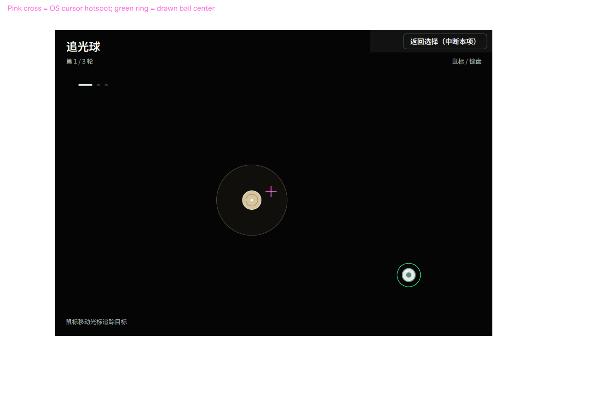
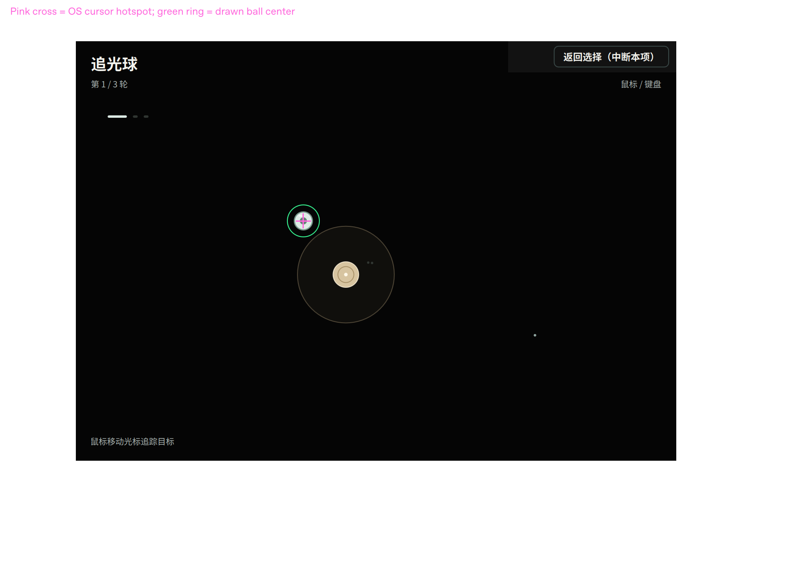

# 2026-11-11 主分支整合与整体检查

用户已明确要求全部合并 main 后进行整体检查。本轮以 main 完整源码和七入口完整运行包交付。

## 合并范围

合并前 GitHub main：`a8a2e7660683fe4fe661e25ca1c61c010669a160`。合并提交：`68faf07`，完整引入 `fix/v5-mouse-rhythm-feedback` 的 `74f0d08`。

通过 Git 祖先检查确认 `feat/neuralife-v5-interaction`（dc31070）、`fix/v5-retest-20261110`（a9a91a9）、`fix/v5-mouse-rhythm-feedback`（74f0d08）均已包含。合并无冲突；合并后运行代码与最新累计修复分支一致，没有择取遗漏。原另一工作目录的未提交修改未被覆盖。

## 追加鼠标偏移反馈

用户截图没有系统鼠标，因此不能从图像量出热点偏移或证明客户端已运行哪次修复。此前测试主要向游戏直接发送 Qt 鼠标事件，并从场景内数值推导球心，未覆盖宿主鼠标覆盖层。不能据此宣称正式客户端偏移已经消除。

新增测试在 pointer 的真实 Loader 外建立宿主缩放层和抢收鼠标的覆盖层，通过 QCursor.setPos 移动系统鼠标，读取实际球体 QQuickItem 中心的屏幕坐标与 QCursor.pos 比较。覆盖层故意发送带 24px 偏移的宿主坐标，是对抗性测试，并非声称 Neuralife 实际使用该公式。

旧实现无法在覆盖层之下持续收到 MouseArea 事件，会保留旧位置或跟随转发坐标。修复改为窗口内容层上的非阻塞 HoverHandler 读取原生窗口热点，再映射到场景；每次推进重新映射已知屏幕热点，避免祖先变换而鼠标静止时偏移。光球显式按自身宽高的一半定位中心。观察器不接管点击，宿主暂停及菜单按钮仍由原有组件处理。

测试截图用粉色十字标出从系统取得的鼠标热点，绿色空心环标出实际球心；这两个辅助标记只存在于测试壳，不进入游戏产品界面。

## 本轮结果

本轮运行代码提交：`620bdebecba68208378d60aef88d531bb57f186b`，在本地 main 合并后执行。整体检查和证据随后作为单独提交进入 main；旧报告仅作为历史证据。

| 范围 | 本轮结果 | 证据 |
|---|---|---|
| 全部七游戏、路径重放、完整打包、同步预检、QML 与窗口布局 | 18/18 测试组 | `tests/results/v5-run-scenarios/result.json` 与各组日志 |
| 所有活动游戏十种代表窗口尺寸 | 70/70 | `tests/results/v5-adaptive/result.json` |
| 追光／打靶流程与输入回归 | 100%／125%／150% 各 127/127 | `pointer/tests/evidence/acceptance-scale-*.json` |
| 系统鼠标热点、实际绘制球心、覆盖层、窗口／父层变化及卸载清理 | 三档缩放各 14/14 | `tests/results/v5-host-cursor/result-scale-*.json` |
| 律动按键、保持与反馈 | 38/38；引擎30/30；布局26/26 | `tests/results/v5-rhythm-input/`、`rhythm/tests/engine-results.json`、`tests/results/v5-rhythm/result.json` |
| 分支完整性与完整包哈希 | 三分支均为 main 祖先；93个运行文件全部 MATCH | `tests/results/v5-main-integration/` |

旧代码 `74f0d08` 在初始覆盖层回归中仅 4/12 通过（8个失败），保存在 `tests/results/v5-host-cursor/before-fix/`，属于预期的修复前失败证据。后续增加两项任务卸载检查，本轮 14/14。新增窗口鼠标观察器在任务卸载前解除外部父对象，避免残留观察器影响下一个游戏。

实际热点与球心的最大逻辑像素误差：100% 约0、125% 0.400、150% 0.472，均小于0.5。125%／150% 的分数坐标包含设备像素取整；不是对正式 Windows 客户端的测量。矩阵仍是61项、6项PASS和55项NOT_TESTED，未将这批自动测试冒充正式宿主全项验收。

| 修复前：粉色热点与球心分离 | 修复后：热点与球心重合 |
|---|---|
|  |  |

上述图片来自测试壳；本轮 pointer 与 host-cursor 通用 PNG 为最后的150%运行，律动通用 PNG 为本轮整体回归的100%运行。各档数值报告独立保存。未修改游戏的渲染字节波动图片未重新提交。

完整运行包：`Neuralife-V5-main-20261111.zip`（约1.45 MiB，七入口、八原有任务模块），本轮生成位置 `/workspace/Neuralife-V5-main-20261111.zip`；SHA-256 为 `8339655d32762e9eade5202a3d1246dcc9cbf3250c71860ec2edbfb9c4b76fc3`。这是完整插件资源包，不含 Neuralife.exe 和 Qt 系统运行库；可由 main 的 `tools/package_v5.py` 重新生成。

## 验收边界

当前可运行的是 Linux Qt 模拟宿主。Windows/macOS 正式客户端、真实音频输出和 BCI 硬件没有实测，61 项矩阵的正式宿主未测项目不能改成 PASS。没有向公司电脑写入或退役正式宿主插件。main 合并与推送得到本轮明确授权。
