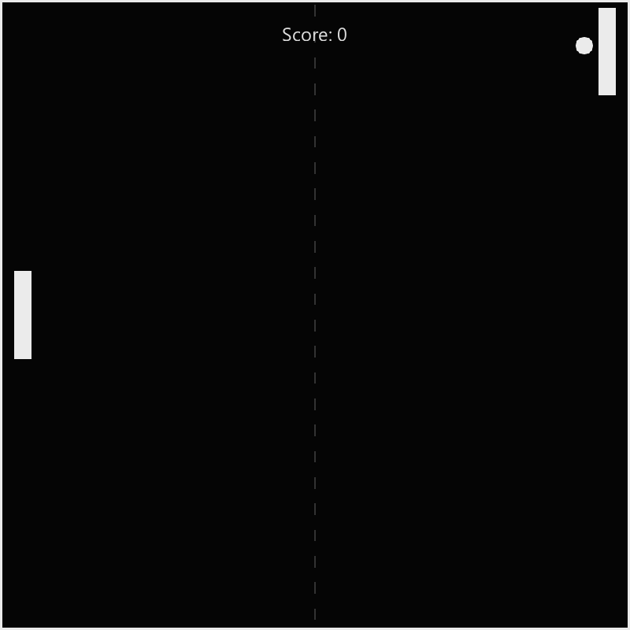

# Neuralife 原版视觉基线采集报告

> 依据：`Neuralife_七款新增游戏_V4_确认版开发规格书.md` §1.1
> 采集时间：2026-11-04
> 采集环境：Windows 10 / Neuralife 宿主 `D:\program\AIT\Neuralife\bin\Neuralife.exe`

## 1. 已采集内容

### 1.1 可用样例

当前安装包 `D:\program\AIT\Neuralife` 的 `bin/modules/games/` 目录下仅有官方提供的两个开发样例：

- `pong/`：GamepadLite 样例
- `balance/`：Cursor 样例（`--game-dev balance` 在当前宿主报 "requires the legacy launcher"，未能通过开发模式加载）

这两个样例**不是**规格书要求的太鼓达人、贪吃蛇、俄罗斯方块、乒乓球、太空射击、中国象棋六款原版游戏，只能作为宿主 Game API 与基础渲染能力的参考，不能作为「原版 Neuralife 游戏视觉规范」的直接依据。

### 1.2 Pong 样例截图

路径：`docs/shots/pong_baseline.png`

观察记录：

| 项目 | 观察值 | 置信度 | 说明 |
|---|---|---|---|
| 画布背景 | 纯黑 `#000000` | 高 | 这是 Pong 样例自己的游戏场景，不是宿主外壳 |
| 前景元素 | 白色矩形球拍 / 圆形球 | 高 | 样例极简绘制 |
| 顶部文字 | "Score: 0"，白色无衬线字体 | 高 | 样例自己的 HUD |
| 宿主顶栏/底栏 | 未出现 | 高 | `--game-dev` 开发模式直接加载游戏插件，不经过宿主主界面 |
| 按钮/弹窗/主题色 | 未出现 | 高 | 样例无完整外围 UI |

### 1.3 无法采集的内容

| 规格书要求 | 状态 | 原因 |
|---|---|---|
| 太鼓达人初始/进行中/暂停/结束页面 | ⛔ BLOCKED | 未随安装包提供，无模块 ID，无法通过 `--game-dev` 加载 |
| 贪吃蛇初始/进行中/暂停/结束页面 | ⛔ BLOCKED | 同上 |
| 中国象棋初始/进行中/暂停/结束页面 | ⛔ BLOCKED | 同上 |
| 俄罗斯方块、乒乓球、太空射击抽样画面 | ⛔ BLOCKED | 同上 |
| 宿主 Light/Mint/Dark 主题对新旧游戏的影响 | ⛔ BLOCKED | 需要进入宿主主程序 Games 页，当前环境无自动化入口 |
| 字体家族、按钮圆角、选中/禁用/暂停颜色、结算样式 | ⛔ BLOCKED | 需要原版游戏实际运行画面 |

## 2. 对 V4 视觉同源的结论

- 由于**未取得原版六款游戏的实际运行画面**，无法完成规格书 `UI-BASE-01` 的并排核对。
- 当前新增七款游戏的视觉方案基于：
  1. 宿主已确认的部分主题线索（Light/Mint/Dark 候选色 `#F6F6F6`、`#EBEBEB`、`#57B6B6`、`#2E8C8C` 等，见规格书 §1.1）；
  2. 避免 V2 硬编码深蓝科技仪表盘风格的改进；
  3. 各游戏玩法场景自身的可读性需求。
- 这属于「新七游戏内部 UI 自洽」方案，**不是**已验证的 1:1 原版视觉复刻。

## 3. 解除 BLOCKED 的条件

需提供以下任一：

1. 包含原版六款游戏的完整 Neuralife 安装包或 `NeuralifeDemo.7z`；
2. 原版六款游戏在目标分辨率/缩放下的实际运行截图（初始、进行中、暂停/结束、各主题模式）；
3. 原版游戏的 QML 源码或 UI 组件库，可直接提取字体、颜色、按钮与弹窗令牌。

在取得上述材料之前，`BASE-01` 验收项保持 `BLOCKED`。
